# MATLB|Optimal Microgrid Configuration for Distributed Power Systems Based on Complex Networks

List of contents  
I. Overview  
II. System Research  
III. Complex Network Framework  
IV. Matlab Code Implementation  
V. Results and Discussion
I. Overview Over the years, scientists in various fields have developed a wide range of tools: mathematics, computing, and statistics, aimed at analyzing, modeling, and understanding networks. The foundation of network research can be traced back to the development of graph theory, with Leonhard Euler analyzing graph theory in 1736, when he wrote the famous Konigsberg Bridges paper. In the context of network theory, complex networks are defined as graphs composed of relatively many interconnected nodes (e.g., structural or functional relationships). It is a network with non-trivial topological features, which does not appear in simple networks such as random graphs but frequently appears in the graph modeling of real systems. According to the previous definition, power system can be classified as complex network and analyzed from the perspective of network theory. The power system is one of the most critical infrastructures. Due to the increase in electricity demand and the global reduction of CO2 emissions, it is experiencing significant changes. In addition, a series of recent natural disasters (such as hurricanes) have partially exposed some vulnerabilities in the power system. Therefore, the nation calls for an increase in grid resilience and self-healing capabilities. This in turn leads to the imperative of smart grids, with microgrids expected to play a significant role. To leverage the maximum advantages of microgrids in power systems. In the power system, the location selection of microgrid is an important aspect that needs to be studied. Previous studies mainly focused on using metaheuristic methods to find the optimal location of distributed generation in microgrids to minimize system losses. Some pre-research in related literature uses complex networks to conduct transient stability assessments by analogy with power systems. We use the concept of a developed controlled distribution grid (CDG) to enhance the resilience within the distribution system of microgrids with high penetration. CDG concept suggests that the load is comprehensively and real-time monitored and controlled through a central controller. This central controller processes "requests" from all loads according to energy management algorithms and returns "authorization." In this paper, a complex network framework for the modified IEEE 30-node system and the concept of centroid are established to determine the optimal location for the deployment of microgrids. Real-time energy management based on the CDG concept is used. This article aims to analyze and find the best location for microgrids in the distribution system.
This paper introduces a new method for finding the optimal location of microgrid (MG) in power distribution systems using complex network analysis. The optimal location refers to that which can enhance grid resilience, reduce power loss, decrease line load, improve voltage stability, and provide safe power supply to critical loads during outages. The criteria used to find the MG's optimal location are based on complex network theory, employing centrality analysis, the concept of centroid used in physics, and the controlled delivery grid (CDG) concept. The IEEE 30-bus system is used as a case study. Results obtained from MATLAB and PowerWorld show the effectiveness of the suggested method for MG placement.
Edit 
Figure 1: IEEE30 Node Case Study 
III. Complex Network Framework
To carefully examine the power system within the context of complex network theory, the first step is to model the system as a graph (i.e., nodes as vertices and transmission lines as edges). Figure 2 shows the corresponding mapping of the original IEEE 30 bus system. It contains 30 nodes/vertices, with 41 links/edges representing the transmission lines that connect each node. In this paper, we use an abstract form of the complex network framework (i.e., unweighted and undirected) to provide some indication of centrality in the most central bus. Additionally, we add different weights at the network edge to explore the impact of power system parameters (i.e., normalized impedance and capacity of the lines) on node centrality. 

Edit 
Figure 2: Mapping of the IEEE 30 Node System
Three main factors were selected to better understand the centrality of the IEEE 30 node system: Betweenness Centrality; Cohesion Centrality; and Closeness Centrality. Betweenness Centrality equals the number of shortest paths from all vertices (i.e., buses) to all other vertices through that vertex. It is designed as a general measure of centrality [16] (i.e., nodes with higher betweenness centrality will have a greater impact on the network). The weight of the betweenness centrality edge is set to the normalized admittance of the line, so it is more relevant to the power flow in the network. For example, the higher the admittance, the higher the chance of power flowing through that node. Using (1) to calculate betweenness centrality. 

Where Nst is the total number of shortest paths from s to t, and C(v, s, t) is the number of shortest paths from v to s and t. 
Closeness Centrality is the average length of the shortest path between a node and all other nodes in the graph. As the closeness centrality of a node increases, it indicates how closely it is connected to the rest of the nodes. The shortest electrical path between any two buses is the shortest electrical distance between them. Therefore, the weight of the edges is chosen as the normalized admittance because closeness centrality is more relevant to distance. Using (2) to calculate closeness centrality.
Editor
Among them, vi is the number of reachable nodes for node i (excluding i), N is the number of nodes in graph G, Ci is the sum of distances from node i to all reachable nodes.
If no node can be reached from node i, then c(i) is zero. The clustering coefficient measures the tendency of nodes in a graph to cluster together. The local clustering coefficient for a vertex quantifies the average number of connections it has with its neighboring vertices. The overall clustering coefficient of the network and the local clustering coefficients for each node can be calculated as in (3) and (4):
Editor
Nv is the number of links between nodes v and Kv is the degree of node.
The local clustering coefficient is calculated to examine the clustering trend of IEEE 30 bus nodes. Additionally, from a power system perspective, a node with a high clustering coefficient may indicate that if it were disconnected, the flow could be directed to surrounding buses via alternative routes. In other words, a high LCC for a node can be seen as an indicator of its low centralization; however, it is not a sufficient metric on its own. The overall clustering coefficient is calculated to explore the average connectivity of the entire 30 bus network at 0.234. If all nodes in the network were interconnected, CC(G) would equal 1). From the complex network analysis in Table 1, it is evident that the influence of Buses 4, 6, and 10 is greater than others. However, using centroid-based analogy, by positioning load centers using (6) and (7) in approximate graphs in [15], Bus 5 would be closest to the load center. In the next section, we will show how the location of the MG affects operational performance:
Editor
The x and y coordinates of the load center are represented by h, Li is a load connected to bus i, n is the number of buses.
IV. Matlab Code Implementation: This document only showcases a portion of the code, the full code can be found in:
Editor
5. Results and Discussion
The positioning of the microgrids (MG) was tested using the modified IEEE 30 bus system described in Section II, with the system being disconnected from the main feeder at Bus 1. Three different algorithms were used to select the location of the microgrids to demonstrate their impact on the CDG. The centroid analogy suggests that the load center is close to Bus 5, hence selecting Bus 5, 3, and 10 as the set of locations for deploying three microgrids (L1). Nodes 3 and 10 were chosen to ensure that the microgrids are spread throughout the network. Based on complex network analysis, sets of locations (L2) were selected for buses 27, 29, and 30 with high clustering coefficients. It is worth noting that the possible solutions for placing M microgrids in an N-bus distribution system are MN. Therefore, in a 30-bus system with 3 microgrids, the possible solutions are 330, not to mention the processing time required to find each solution, which would be substantial to find the optimal solution. Using the proposed complex network method will reduce the number of possible microgrid placement options, thus reducing the processing time needed to find the optimal microgrid location.
The distribution system is examined through a complex network framework to obtain metrics regarding the reasonable and optimal placement of microgrids. Analysis is conducted using complex network theory, centroid concept, and centrality analysis within the controllable delivery grid (CDG) concept. The IEEE 30-bus test case has been used to validate the effectiveness and applicability of the proposed method. Notably, exploring all possible solutions for placing M microgrids in an N-bus distribution system requires significant time. Complex network theory makes a significant contribution in indicating the optimal placement of microgrids in distribution systems to enhance their resilience.
Editor

## Images

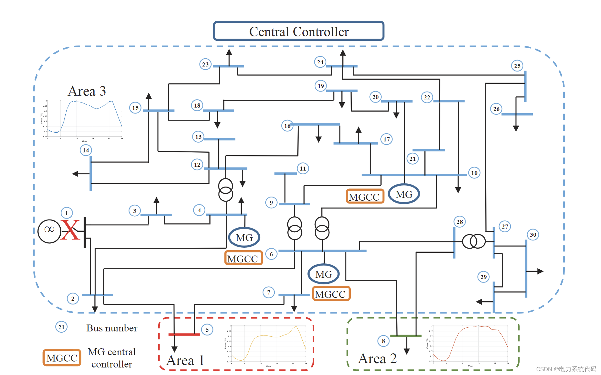
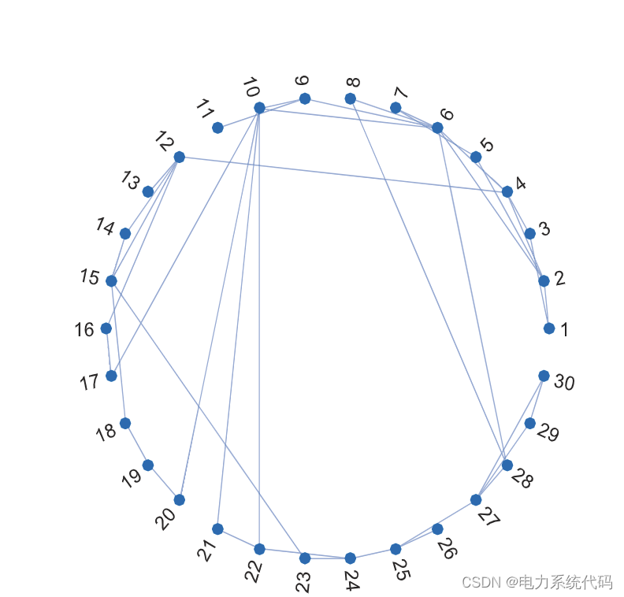
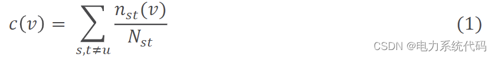
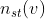
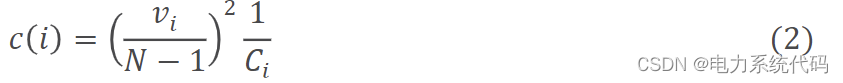
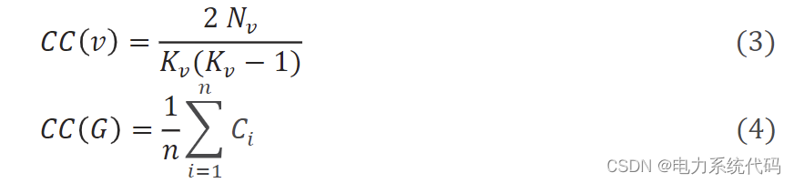
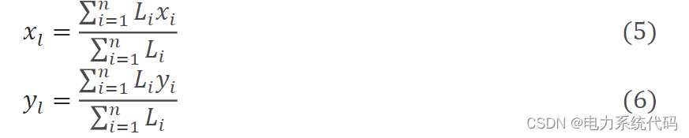
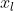
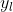
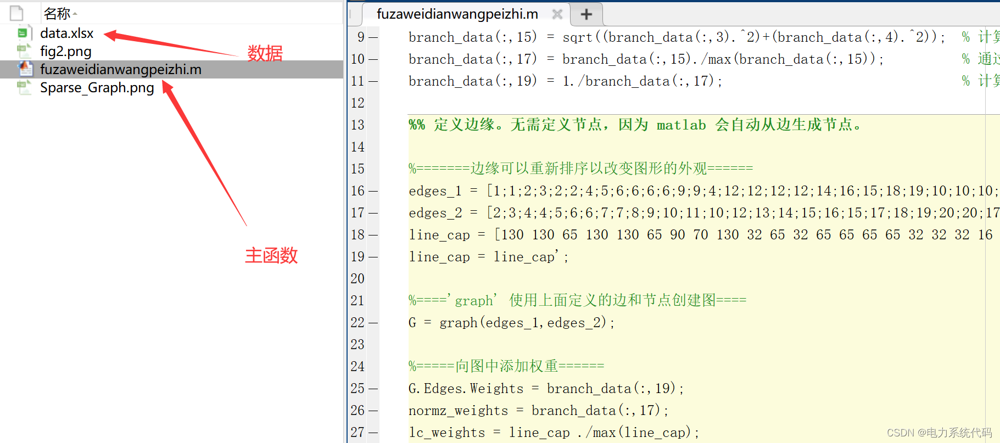
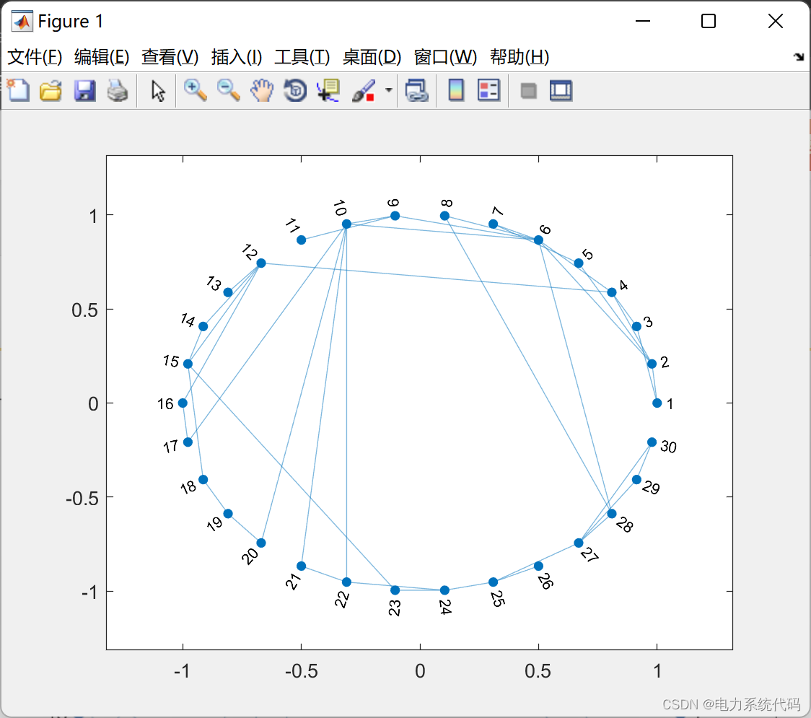
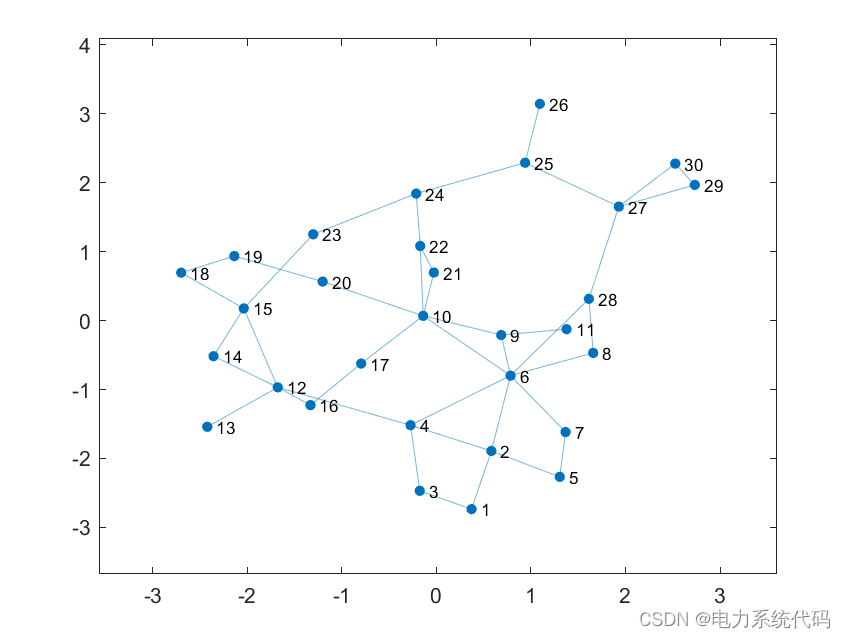

<!-- PAYMENT_BLOCK -->

## Get this dataset

- Payment link (Stripe): [Buy now](https://buy.stripe.com/3cs8yP7sY87d0vu9AB)
- Payment QR code: 

<!-- /PAYMENT_BLOCK -->
